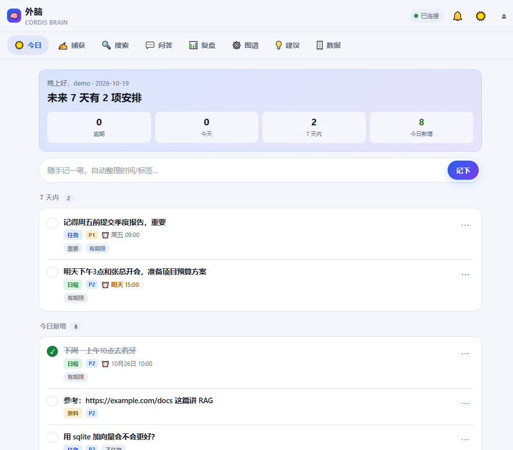
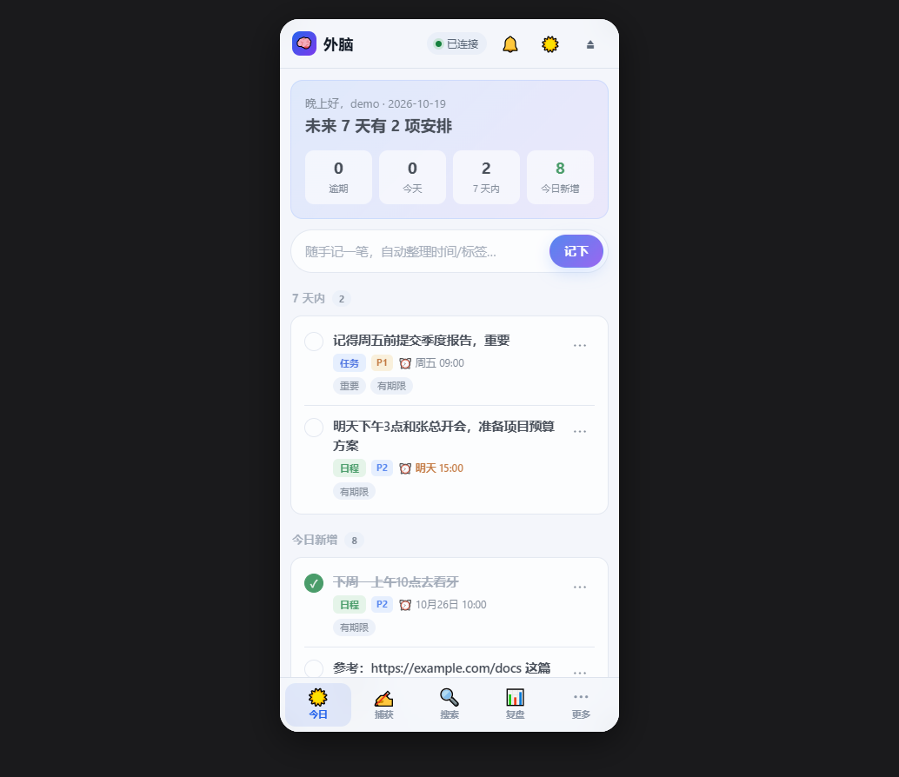
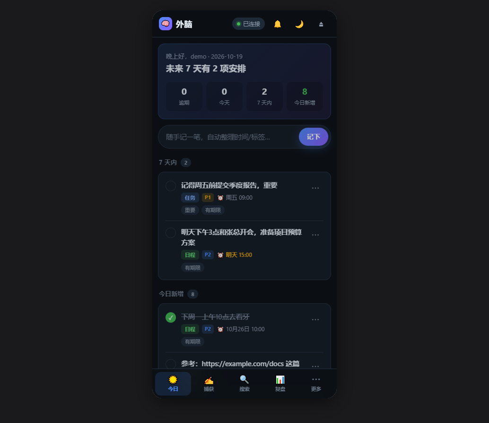

# 外脑 · Cordis Brain —— Android APK 打包说明

把仓库里的「外脑」服务（`brain/` + `cordis/` + `web/`，纯标准库、零依赖）打包成一个
**自包含的 Android APK**：包内跑一个本机 Python 服务，再用 Android WebView 指向
`http://127.0.0.1:8787/` 显示前端界面。全程离线可用，不需要网络、不需要存储权限。

技术栈：**python-for-android（p4a）** + 其自带的 **`webview` bootstrap**，由
**buildozer** 驱动，在 **Docker** 里构建（Windows 无法原生跑 p4a）。

---

## 1. 目录里有什么

| 文件 | 作用 |
| --- | --- |
| `main.py` | **APK 的 Python 入口**（p4a 要求入口必须叫 `main.py`）。把「外脑」插件栈起在 `127.0.0.1:8787` 并阻塞。 |
| `config.toml` | **随 APK 打包**的配置。默认 `ai.provider = "heuristic"`（离线、零依赖、即开即用）。 |
| `buildozer.spec` | buildozer 配置：`p4a.bootstrap=webview`、`p4a.port=8787`、`title=外脑`、`android.archs=arm64-v8a` 等。 |
| `build_android.sh` | **容器内**的构建脚本（预置 p4a 源码 → 网络适配 → 注入麦克风/文件选择补丁与启动页 → 拼装源码目录 → `buildozer android debug` → 回传 APK）。 |
| `build_apk.ps1` | **Windows 一键构建**（自动启动 Docker、拉镜像、挂持久化卷、跑上面的脚本）。 |
| `dist/` | 构建产物（`*.apk`），构建后生成。 |

> 项目根目录（`brain/`、`cordis/`、`web/`、`server.py` …）**不会被改动**。
> `build_android.sh` 只在构建时把源码**临时拼装**到工作区的 `app/` 目录作为 `source.dir`，
> 因此仓库里不会多出一份重复的源码副本。

---

## 2. 前置条件

- **Docker Desktop**（Windows）。脚本会自动尝试启动它，也可先手动启动。
- 首次构建需要联网下载 Android SDK / NDK 等，**约 2~3 GB**。

```powershell
docker version        # 确认引擎可用
```

---

## 3. 一键构建

在**项目根目录**执行：

```powershell
powershell -ExecutionPolicy Bypass -File android\build_apk.ps1
```

参数：

| 参数 | 说明 |
| --- | --- |
| `-Image <镜像>` | 默认 `kivy/buildozer:latest` |
| `-NoStart` | 不自动尝试启动 Docker Desktop |

**首次约 30~60 分钟**（下载 + 编译 CPython 发行版与各依赖）；之后有缓存会快很多。

### 手动等价命令（不想用 ps1 时）

```powershell
docker run --rm --user root `
  -e HOME=/root `
  -e GRADLE_USER_HOME=/root/.buildozer/.gradle `
  -e SRC=/src -e WORK=/root/.buildozer/work `
  -v "D:/outbrain/worktable:/src" `
  -v "cordis_buildozer_home:/root/.buildozer" `
  --entrypoint bash kivy/buildozer:latest /src/android/build_android.sh
```

> `--entrypoint bash` 是**必须**的：镜像默认 entrypoint 会直接 `exec buildozer`，
> 没法跑我们的 bash 脚本。

构建结束后，APK 会出现在 `android/dist/`（形如 `cordisbrain-0.1.0-arm64-v8a-debug.apk`），
是 **debug 签名**，可以直接安装，无需自备签名。

### 缓存

命名卷 **`cordis_buildozer_home`** 挂在容器 `/root/.buildozer`，持久化：

- Android SDK / NDK
- gradle 缓存、`GRADLE_USER_HOME`
- p4a 源码、**已编译好的 Python 发行版**

重跑会复用这些，快很多。想**彻底重来**：

```powershell
docker volume rm cordis_buildozer_home
```

构建日志：脚本会把日志 tee 到卷内 `/root/.buildozer/work/buildozer.log`，
并在结束时回传到 `android/buildozer.log`（用 `build_apk.ps1` 时同时打印在控制台）。

---

## 4. 安装到手机

把 `android/dist/*.apk` 传到手机安装（需在系统里允许「安装未知来源应用」）。或者用 adb：

```powershell
adb install -r android\dist\cordisbrain-0.1.0-arm64-v8a-debug.apk
```

桌面图标名称来自 `buildozer.spec` 的 `title = 外脑`；
安装包名是 `org.cordis.cordisbrain`，应用数据目录为
`/data/data/org.cordis.cordisbrain/files/app/`。

---

## 5. 首次使用

App 打开后就是「外脑」的网页界面（本机 WebView 访问 `127.0.0.1:8787`）：

1. 先**注册**一个账号（`/api/auth/register`）。**第一个注册的用户是管理员**，只有他能改全局设置。
2. 之后所有接口都需要登录后的 Bearer token（前端自动用 `localStorage` 保存）。
3. 直接输入一句话捕获，例如「明天下午3点和张总开会，准备项目预算方案」——
   默认的 `heuristic` 引擎会离线解析出时间、类型和标题。

### 界面预览

桌面（顶部导航 + 侧宽布局）：



手机（底部 tabbar + 安全区适配，浅色 / 深色）：

| 浅色 | 深色 |
| --- | --- |
|  |  |

前端是手机优先的单页应用，拆成三个文件（`web/index.html` + `web/app.css` + `web/app.js`），
零构建、零依赖，直接由 `brain/http.py` 的静态路由提供：

- **手机**：底部 5 个 tab（今日 / 捕获 / 搜索 / 复盘 / 更多）+ `safe-area` 适配 + `viewport-fit=cover`；
  **桌面**：顶部 navbar，内容居中限宽。
- **深浅两套主题**（`localStorage: cb_theme`），右上角太阳/月亮一键切换。
- **不用任何原生 `alert/confirm/prompt`**：p4a 的 WebView 里没有 `WebChromeClient` 时原生对话框是坏的，
  所以确认框/输入框/详情面板全部是自绘的底部 sheet 与 toast。
- 空态、骨架屏、错误态、逾期标记、条目详情（编辑 / 拆分 / 完成 / 删除）、文件与语音捕获都已接好真实 API。

---

## 6. 接内网大模型（可选）

默认 `heuristic` 完全离线。想用内网 LLM，在**应用内 → 设置**里改（仅管理员）：

- 把 `ai.provider` 改成 `openai`（OpenAI 兼容接口）；
- 填 `base_url` / `api_key` / `model` / `embed_model`；
  默认示例是公网通用地址 `https://api.openai.com/v1`（`gpt-4o-mini` / `text-embedding-3-small`），
  也可以填任何 OpenAI 兼容端点（DeepSeek、通义、自建网关等）；
- 保存后**热生效**，无需重启 App。

设置会写回应用私有目录下的 `config.toml`。
（出于安全考虑，桌面端的 `config.toml` 里若有内网 key，**不会**被打进 APK。）

---

## 7. 国内网络适配（构建脚本自动处理）

本机到若干海外源不可达或极慢，`build_android.sh` 在构建前会自动做一次「网络适配」，
把所有下载改到可达的镜像，并给下载加上超时（**默认 `urlopen`/`urlretrieve` 没有超时，
连接断流会永久卡死**——这正是第一次构建卡住的原因）：

| 原本 | 改成 | 原因 |
| --- | --- | --- |
| `github.com/<o>/<r>/archive/...` | `codeload.github.com/<o>/<r>/tar.gz\|zip/...` | `github.com` 直连不通；codeload 是 GitHub 归档的同一后端，**字节完全一致、解包目录名不变** |
| `github.com/<o>/<r>/releases/download/...` | `ghproxy.net/https://github.com/...` | release 资产 codeload 不提供 |
| `www.openssl.org/source/...` | `codeload.github.com/openssl/openssl/tar.gz/refs/tags/openssl-<ver>` | openssl.org 握手超时；华为云**并没有**镜像 openssl（其 `/openssl/source/` 返回的是门户 HTML，解包会失败） |
| `python/cpython/archive/tags/v<ver>` | `mirrors.huaweicloud.com/python/<ver>/Python-<ver>.tar.xz` | codeload 被限速到 ~20KB/s，两个 22MB 归档要白白多花 ~40 分钟；华为云 ~815KB/s |
| `services.gradle.org/distributions/gradle-8.14.3-all.zip` | `mirrors.cloud.tencent.com/gradle/gradle-8.14.3-bin.zip` | gradle 服务连不上；顺带用 `-bin` 省 ~90MB |
| Apache ANT 下载 | 直接跳过 | gradle 构建用不到；`archive.apache.org` 几乎不可达（脚本会建好 `apache-ant-1.9.4/` 空目录，buildozer 见目录存在即跳过） |

另外脚本会给 `buildozer` 的下载（SDK/NDK）和 `p4a` 的 `urlretrieve` 都设 **120s 超时**；
断流时 `p4a` 自带最多 5 次重试。

p4a 的 `unpack()` 只按**文件名后缀**判断压缩包类型，而镜像 URL 结尾没有 `.tar.gz`
（例如 codeload 的 `.../tar.gz/refs/tags/openssl-3.3.1`），脚本会额外打一个
「按内容嗅探（`tarfile.is_tarfile` / `zipfile.is_zipfile`）」的兜底补丁。

> 这些都是**构建期**在容器里对「源码副本」做的临时修改，**不会改动仓库里的任何文件**。

Android SDK / NDK（约 800MB）和 Gradle / Maven 依赖仍从 `dl.google.com`、`repo1.maven.org`
下载，速度约 0.3~0.6 MB/s，慢但可用。

---

## 8. 关键约束 / 已知事项

- **端口必须一致**：`buildozer.spec` 的 `p4a.port = 8787` 与 `main.py` 的 `PORT = 8787`
  必须相同。webview bootstrap 的 Java 侧会轮询 `127.0.0.1:<p4a.port>`，
  端口通了才把 WebView 指过去。
- **只监听本机**：`main.py` 固定 `host = 127.0.0.1`，不对外暴露。
- **时区回退**：Android 没有 `/usr/share/zoneinfo`，`zoneinfo` 会失败。
  `main.py` 的 `_fix_timezone()` 会回退成固定 `UTC+8`（对 `Asia/Shanghai` 完全等价，
  中国无夏令时），避免到期时间差 8 小时。其它时区见 `main.py` 里的 `offsets` 表。
- **前端 token 依赖 localStorage**：p4a 的 WebView 已开
  `setJavaScriptEnabled` + `setDomStorageEnabled`，所以前端登录态能持久化。
- **root 构建**：容器里以 root 构建（只是个沙箱），因此 `buildozer.spec` 里设了
  `warn_on_root = 0`，否则 buildozer 会 `input()` 交互确认，在非交互环境下卡死。
- **本机网络限制**：本机直连 `github.com` 不通，`build_android.sh` 改从
  `codeload.github.com` 下载 p4a 源码 tarball，并把它初始化成「已是 git 仓库且
  remote/branch 一致」的状态，骗过 buildozer 的 clone 检查。

---

## 9. Android 端能力补丁（麦克风 / 文件选择 / 下载）

p4a 自带的 `webview` bootstrap **只装了最基础的 WebView**：`PythonActivity` 里
没有 `setWebChromeClient(...)`。在 APK 里这意味着：

| 现象 | 原因 |
| --- | --- |
| 语音捕获点了没反应 / 一直被拒绝 | `getUserMedia()` 需要 `WebChromeClient.onPermissionRequest()` 授权，没有它一律拒绝 |
| `<input type="file">` 点了没反应 | 需要 `onShowFileChooser()` 拉起系统选择器 |
| 导出 JSON / 备份下载静默失败 | 需要 `DownloadListener` 把链接转给系统浏览器/下载器 |
| 看不到 JS 报错 | 需要 `onConsoleMessage()` 转发到 logcat |

`build_android.sh` 的 `patch_android()` 会在构建前给 `PythonActivity.java` 打补丁
（**幂等**：检测到 `CORDIS_PATCH_V3` 标记就跳过；若只是旧版补丁，会 `git checkout`
回滚到 p4a 原始文件后重新打），同时把 p4a 的英文 Loading 页换成
「外脑」品牌启动页。补丁会写到三处，保证「重建 dist」和「复用已有 dist」都能生效：

1. p4a 的 bootstrap 源码（`.../bootstraps/webview/build/`）—— dist 被重建时用；
2. `build-arm64-v8a/bootstrap_builds/*`（存在时）；
3. 已生成的 `dists/cordisbrain/`—— 直接 gradle 编译时用。

### 麦克风权限链路

`buildozer.spec` 里已声明：

```ini
android.permissions = INTERNET, RECORD_AUDIO
```

`RECORD_AUDIO` 是**危险权限**，Android 6+ 必须在运行时申请。补丁实现的链路是：

1. **App 启动 0.8 秒后**先申请一次录音权限（`cordisRequestAudioPermission()`），
   让系统弹窗在用户第一次点「语音」之前就处理掉，避免授权与 WebView 的 `grant()`
   撞在一起；
2. 网页调用 `navigator.mediaDevices.getUserMedia({audio: ...})`；
3. WebView 回调 `onPermissionRequest()`，发现请求的是 `RESOURCE_AUDIO_CAPTURE`；
4. 如果 `RECORD_AUDIO` 还没授权 → 再 `requestPermissions(...)` 弹**系统**权限框
   （requestCode `0x0C0D`），网页的请求挂起；
5. 用户在系统框点「允许」→ `onRequestPermissionsResult()` 里再
   `request.grant(RESOURCE_AUDIO_CAPTURE)`，`getUserMedia` 才真正成功；点「拒绝」→ `deny()`；
6. 之后再次录音不会重复弹框（已授权直接 `grant`）。

**采集参数降级与原生录音兜底**：有些机型/系统上，带 `echoCancellation` / `noiseSuppression` 的采集
会走 `VOICE_COMMUNICATION` 音频源，`AudioRecord` 起不来，报
`can't start audio source`；还有的 ROM（MIUI / ColorOS 等）直接让 WebView 拿不到麦克风，
报 `NotReadableError`。前端因此按「最简 → 默认」逐级重试：

```js
{ audio: { echoCancellation:false, noiseSuppression:false, autoGainControl:false, channelCount:1 } }
{ audio: { echoCancellation:false, noiseSuppression:false, autoGainControl:false } }
{ audio: true }
```

APK 里还会优先走 **原生录音**：Java 侧注册了 `CordisAudio` JS 桥（`CordisAudioBridge`），
直接调用 Android 的 `MediaRecorder`（AAC / 单声道 / 64kbps）录到 `cacheDir/cordis_voice.m4a`，
停止时把文件读成 base64 返回给网页，再走原有的 `/api/capture/upload`（`source: voice`）。
这样完全绕开 WebView 的音频栈，WebView 那条路只作为桌面浏览器的兜底。

| 桥方法 | 作用 |
| --- | --- |
| `CordisAudio.available()` | 恒为 `"1"`，网页用它判断「是否在 APK 里」 |
| `hasPermission()` / `requestPermission()` | 查询 / 申请 `RECORD_AUDIO` |
| `start()` | 开始录音；返回 `OK` / `NOPERM` / `ERR:...` |
| `stop()` | 停止并返回 base64（失败返回 `ERR:...`） |
| `openSettings()` | 跳到本应用的系统权限页（连续两次缺权限时自动调用） |

只有权限类错误（`NotAllowedError` / `NotFoundError` / `SecurityError`）才直接失败，
设备类错误会自动换下一组参数重试；`MediaRecorder` 创建失败时也会退回到平台默认编码。

> 前端在录音失败时会用 toast 提示具体错误名，并保留手动输入/文件输入的路径，
> 不会因为麦克风问题卡死。

### 文件选择与下载

- **文件选择**：`onShowFileChooser()` 用 `params.createIntent()` 拉起系统选择器，
  requestCode `0x0C0E`；结果在 `onActivityResult()` 里回传给 WebView（支持多选）。
  前端「捕获 → 上传文件」用的就是它。
- **下载**：`DownloadListener` 把 `http(s)` 链接交给系统 `ACTION_VIEW`；
  `blob:` / `data:` 这类 WebView 内部 URL 无法转发，会 toast 提示。
  （前端的备份下载是带 `?token=` 的普通 `http://127.0.0.1:8787/...` 链接，
  所以这里会走系统浏览器下载。）

### 启动页

`_load.html`（`file:///android_asset/_load.html`）是 p4a 在 Python 服务起来之前
显示的过渡页。补丁把它替换成「外脑」深色启动页（品牌方块 + 三个跳动圆点 +
「正在启动本地服务…」）。页面跳转是 **Java 侧** `WebViewLoader` 轮询到端口可连后
调 `loadUrl("http://127.0.0.1:8787/")` 完成的，所以启动页里**不需要**任何跳转脚本。

> 所有补丁都只作用于容器内的 p4a 副本 / 构建工作区，**不改仓库里的文件**。

---

## 10. 改应用名 / 其它常见修改

- **改桌面图标名称**：改 `buildozer.spec` 的 `title`（会写进 `strings.xml` 的 `app_name`）。
- **改包名**：改 `package.name` / `package.domain`（注意 APK 文件名取自 `package.name`）。
- **改架构 / 最低版本**：`android.archs`（默认 `arm64-v8a`）、`android.minapi`（默认 `24`）。
- **加依赖**：目前 `requirements = python3` 就够——`webview` bootstrap 会自动带上
  `python3 / android / genericndkbuild / pyjnius / sqlite3 / openssl / libffi`。
  项目本身零依赖（`jieba`/`requests` 都是可选增强，缺失会自动降级）。

---

## 11. 构建流程速览（`build_android.sh` 做什么）

1. **预置 p4a 源码**：首次运行时从 `codeload.github.com` 下载并 `git init` 成可识别的仓库。
2. **国内网络适配**：见上一节（改下载源 + 加超时 + 跳过 ANT + 解包嗅探）。
3. **Android 端能力补丁**：给 `PythonActivity.java` 注入 `WebChromeClient`
   （麦克风授权 / 文件选择 / JS 日志）+ `DownloadListener`，并替换启动页。
4. **拼装 `source.dir`**：把 `main.py` + `config.toml` + `brain/` + `cordis/` + `web/`
   复制到工作区 `app/`（清掉 `__pycache__` / `*.pyc`）。
5. **构建**：`buildozer android debug`。
6. **回传**：把 `bin/*.apk` 拷到 `android/dist/`；无论成功失败都把日志拷到 `android/buildozer.log`。
